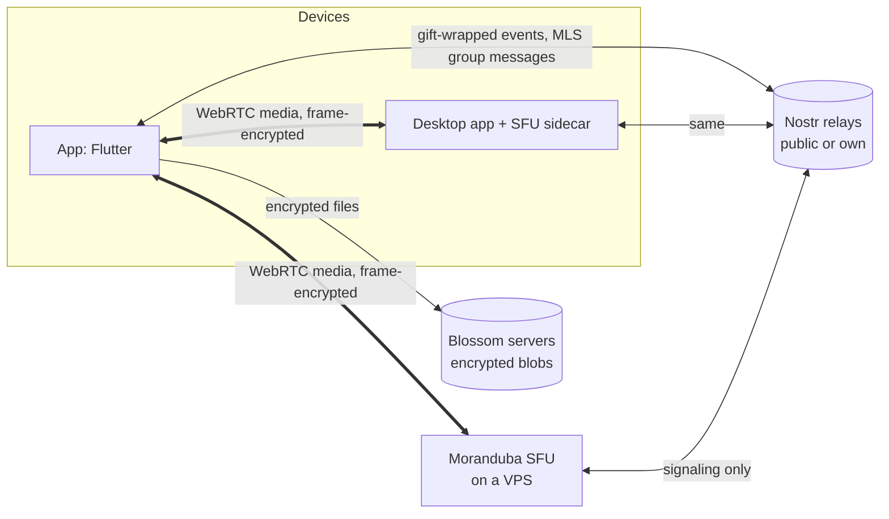
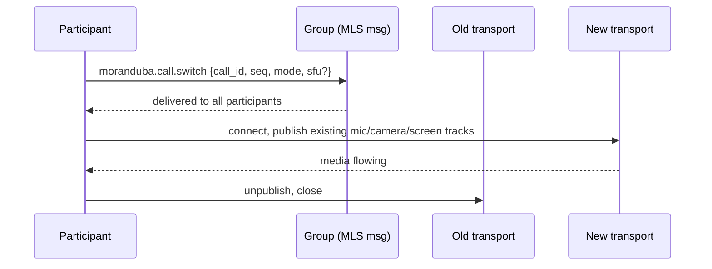

# Moranduba — architecture

Private group chat with video calls and screen share. No accounts: identity is a
Nostr key pair. Every call is end-to-end encrypted, whichever mode carries it.

Status: phases 0 to 5 built; web is tested end to end. Desktop, Android and
iOS builds still need a run on each OS (see the phase table).
Kind numbers and message shapes marked *provisional* are ours and may change.

## Goals

- Friend list and groups over Nostr, no login, no server required to chat.
- Group calls of up to ~15 people with camera, mic and screen share.
- A call runs in one of three modes and can switch mode mid-call.
- Running your own server is one `docker run` and a paste of an npub.
- No component outside the group can read messages, files or call media.

Non-goals for v1: calls larger than ~25, recording, public rooms. The web
client covers chat; calls on the web come later.

## System overview



| Component | Carries | Sees |
|---|---|---|
| Nostr relays | Chat, invites, call signaling | Ciphertext, timing, recipient pubkeys of gift wraps |
| Blossom servers | Chat attachments | Ciphertext blobs and their size |
| Moranduba SFU (host peer or VPS) | Call media | Encrypted frames, participant IPs, bitrate |
| TURN (when needed) | Call media for peers that can't connect directly | Encrypted packets, IPs |

## Identity and friends

- First launch generates a secp256k1 key pair, stored in the platform secure
  store (Keychain, Android Keystore, libsecret, DPAPI). Import of an existing
  nsec and remote signers (NIP-46, NIP-55) come later.
- Friend requests and 1:1 chat: NIP-17 private DMs (NIP-44 + NIP-59 gift wrap).
- Friend requests are NIP-17 messages carrying a `["moranduba",
  "friend_request"]` tag; the answer carries `["moranduba", "friend_accept"]`.
  Crossed requests count as accepted. Declines are silent.
- The friend list is **not** a NIP-02 contact list (that is public). It is a
  NIP-51 follow set (kind 30000, `d=moranduba-friends`) with every entry in the
  NIP-44-encrypted content, so relays only see that a list exists.

## Groups and chat — Marmot (MLS over Nostr)

- Groups use the Marmot protocol (MLS) through MDK 0.8, in our own crate
  (`app/rust/`) that runs as FFI on desktop and as wasm in the browser. See
  [ADR 0001](adr/0001-mls-engine.md) for why, and for the limits that come
  with it.
- MLS gives forward secrecy and post-compromise security, and a new epoch on
  every join, leave or removal.
- Chat messages are Marmot application messages (kind 445 on relays).
- Attachments follow MIP-04: encrypted on device with a key derived from
  `MLS-Exporter("marmot", "encrypted-media", 32)`, uploaded to Blossom.
- Each group has a relay list. Defaults are public relays; a group can add its
  own relay to cut metadata exposure.

### Groups now, channels later

v1 ships plain groups, but the data model is already a space with channels, so
Discord-style communities don't need a migration:

```
Space    { id, name, settings, channels: [Channel] }
Channel  { id, space_id, kind: text | voice, mls_group_id }
```

- v1: every group is a space with exactly one channel, which has both text and
  a call button. The UI hides the space layer.
- Later: a space gets more channels, each backed by its own MLS group, so
  per-channel membership and roles map to MLS membership. Calls and
  `preferred_sfu` are per space; channels inherit them.
- MLS cost grows with members, so spaces above ~100 members need their own
  design pass.

Call servers travel as one MLS application message, re-sent on each new
epoch so new members learn them. Each value is last-writer-wins by
`set_at`; host peers merge per pubkey, and only a host's own desktop opts
it in or out.

```json
{
  "t": "sfu",
  "sfu": { "pubkey": "<hex or empty>", "set_at": 1730000000 },
  "hosts": { "<hex>": { "on": true, "set_at": 1730000000 } }
}
```

## Calls

### Media encryption (all modes)

- Frames are encrypted with flutter_webrtc `FrameCryptor` (AES-GCM, SFrame-like)
  before they leave the sender, so any SFU or TURN forwards only ciphertext.
- Call key: `MLS-Exporter("moranduba", "call:" + call_id, 32)` from the group's
  current epoch. When membership changes, the epoch moves on and every client
  sets the new key; FrameCryptor keeps the previous key briefly so in-flight
  frames still decrypt.
- Switching mode never touches the key, so switching is a transport change only.

### Modes

| Mode | Media path | Good for | Limits |
|---|---|---|---|
| `mesh` | Every peer to every peer | Any group, no setup | Audio fine at 15 (~0.5 Mbps up each). Video capped at ~5 senders; one screen share at reduced bitrate |
| `host_peer` | All peers to one member's desktop sidecar SFU | Groups with one member on a desktop with good upload | Needs ~20 Mbps upload on the host for 15 people. Desktop only |
| `server` | All peers to a Moranduba SFU on a VPS | Groups with a server, own or borrowed | Any size up to the VPS bandwidth |

`host_peer` and `server` run the **same SFU binary** and the same client
transport. The only difference is whether the SFU's npub belongs to a member's
desktop or to a VPS.

### Mode selection

At call start, and again whenever the current transport fails:

1. `server` if the group's `preferred_sfu` answers a ping within 3 s.
2. Else `host_peer` if a listed host peer is online and opted in, newest
   opt-in first.
3. Else `mesh`.

All candidates are pinged at once, so a dead server costs one timeout. A
call already running keeps the route its participants announce (`mode`
and `sfu` ride on presence signals), so a late joiner picks the same host.
If two participants still end up on different SFUs, or one on mesh, the
call falls back to mesh.

Any participant can switch the mode by hand at any time. A switch names the
SFU the initiator reached, so everyone moves to the same one. The UI shows
the current mode and a one-tap switch.

### Call push

An SFU keeps a VAPID key and, per allowed member, up to eight push
subscriptions (`push.json`). With notifications on, the app sends
`push_subscribe` to every SFU its groups use: web through a service worker
registration per SFU (one subscription each), Android through UnifiedPush.
Starting a call sends `ring` with the group's members to its SFUs; the SFU
pushes only to allowlisted members, at most once per 10 s per caller, and
`stop` when the call ends. The payload is the caller's pubkey and the call
id, no group name: the woken app finds the call through presence.

### Mid-call switch (make before break)



- Local tracks are reused, so there is no new permission prompt and no capture restart.
- Conflicts: highest `(seq, created_at, pubkey)` wins, so every client converges.
- If the new transport fails within 10 s, clients stay on the old one and post
  a `moranduba.call.switch_failed`.

### Signaling

- Between members (mesh offers and answers, `join`/`here`/`leave` presence,
  `switch`): MLS application messages inside the group, inner kind 25050
  (*provisional*). Relays see only group events; the key never leaves MLS.
- To an SFU: gift wraps with ephemeral outer kind 21059, so relays forward
  without storing them. Shapes in [ADR 0002](adr/0002-sfu-protocol.md).
- After the first connection to an SFU, renegotiation moves to a WebRTC
  DataChannel. Relays only see the bootstrap.
- Offers carry every ICE candidate (no trickle).
- Presence heartbeats carry the sender's mode. A member on `mesh` while
  others use `server` (it could not reach the SFU) moves the call to `mesh`,
  which works for everyone.

### NAT traversal

- STUN finds public addresses. Direct connections work for most home networks.
- A VPS SFU has a public IP and embeds a TURN server (pion/turn), so `server`
  mode always connects.
- `mesh` and `host_peer` without any server: open question, see below.

## Moranduba SFU

- Go, built on Pion. Starting points: Pion's `sfu-ws` example, the
  `inlivedev/sfu` library.
- Features: simulcast (3 layers), per-receiver layer selection, last-N video
  (active speaker plus the 5 most recent), top-3 loudest audio forwarding,
  DataChannel signaling after bootstrap, embedded TURN.
- Identity: generates its own Nostr key pair on first start and prints its npub.
- Ownership: the first start also prints a one-time claim code. The first app
  that sends it becomes the owner. The owner manages an allowlist of member
  npubs; the app syncs it from the group roster. Strangers can't join, and even
  if one did, frames stay encrypted.
- Desktop: the same binary ships as a sidecar in the macOS, Windows and Linux
  app bundles. The app starts it as a subprocess only while hosting.

Server setup, the whole thing:

```sh
docker run -d --name moranduba-sfu \
  --network host \
  -v moranduba-sfu:/data \
  ghcr.io/vzsoares/moranduba-sfu
docker logs moranduba-sfu   # prints npub + claim code
```

No domain, no TLS certificate, no reverse proxy: signaling goes through Nostr,
and media is DTLS-SRTP plus frame encryption.

## Platforms

| Platform | Calls | Screen share | Host peer |
|---|---|---|---|
| macOS, Windows, Linux | Yes | `getDisplayMedia` via flutter_webrtc desktop capturer | Yes |
| Android | Yes | MediaProjection + `CallService` (foreground service, also keeps calls alive in the background) | No |
| iOS | Yes | ReplayKit Broadcast Upload Extension (`ios/Broadcast`, App Group socket to flutter_webrtc) | No |
| Web | Yes | `getDisplayMedia` | No |

## Repo layout

```
moranduba/
  app/       Flutter client
    rust/    MLS engine: desktop FFI and browser wasm
  site/      Landing page
  sfu/       Go SFU (server image + desktop sidecar)
  docs/      This file, ADRs
```

## Phases

| Phase | Scope | Status |
|---|---|---|
| 0. Foundations | Repo, identity, relay pool, NIP-17 DMs, friend requests, private friend list | Done |
| 1. Groups + chat | MDK integration, space/channel model, create, invite, leave, text, MIP-04 attachments | Done |
| 2. Mesh calls | FrameCryptor + MLS call key, audio, video, screen share, auto video cap | Done |
| 3. SFU | Go SFU, claim + allowlist, simulcast, last-N, embedded TURN, Docker image | Done; image not published |
| 4. Host peer + switching | Desktop sidecar packaging, mode selection, make-before-break switch | Done; sidecar untested inside real desktop bundles |
| 5. Platform polish | iOS broadcast extension, Android foreground service, native notifications (flutter_local_notifications) | Built; Android, iOS and desktop notifications not yet run on a device |

Added along the way: profiles (name and picture, encrypted), disappearing
messages (per-chat timer, NIP-40), attachments in DMs (NIP-17 kind 15),
media viewer, landing page.

## Open questions

1. **TURN without a server.** In `mesh` and `host_peer` with no VPS, roughly
   10–20% of peer pairs can't connect directly. Options: a public TURN service,
   routing through another member, or a community list of TURN servers.
2. **Incoming-call push on iOS apps.** Each SFU rings members' devices
   through Web Push (browsers, iOS home-screen web apps) and UnifiedPush
   (Android, with a distributor such as ntfy); see "Call push" below.
   Native iOS and Firebase push need the publisher's Apple and Google
   credentials, so a self-hosted SFU cannot send them.
3. **MDK exporter API.** Confirm MDK exposes `MLS-Exporter` with a custom label
   for the call key. If not, derive the call key via HKDF from the MIP-04
   exporter secret with a distinct info string.
4. **Metadata on public relays.** Gift-wrap recipients and MLS group IDs are
   visible to relays. Document what leaks for users, and suggest an own relay.
5. **SFU quality vs LiveKit.** Plan tuning time for congestion control and
   simulcast switching before calling `server` mode done.

## Prior art

- 0xchat: 1:1 P2P calls with Nostr signaling (`ox_calling`). MIT, reusable.
- HiveTalk (vanilla): mediasoup SFU. AGPLv3, reference only, no code copied.
- Honey (HiveTalk 2.0): LiveKit + NIP-98 auth + NIP-53 rooms.
- Nests: MoQ audio relay + NIP-98 auth sidecar, server lists per user.
- White Noise / Marmot: MLS group messaging over Nostr.
- Stoat (formerly Revolt): Discord-style servers, channels, roles, voice. UX
  reference only: centralized, email accounts, messages stored readable by
  the operator, no E2EE. AGPLv3.
