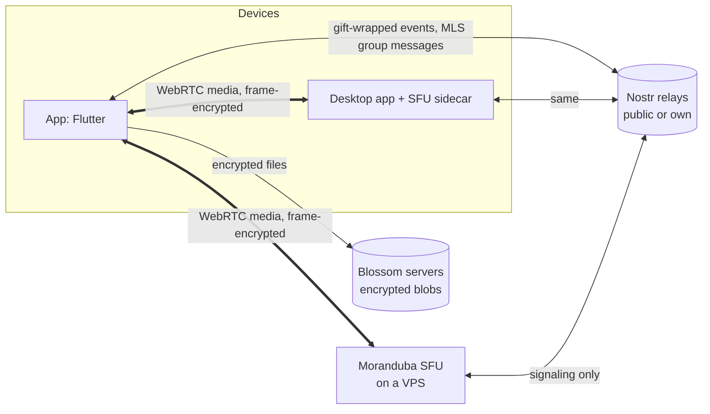
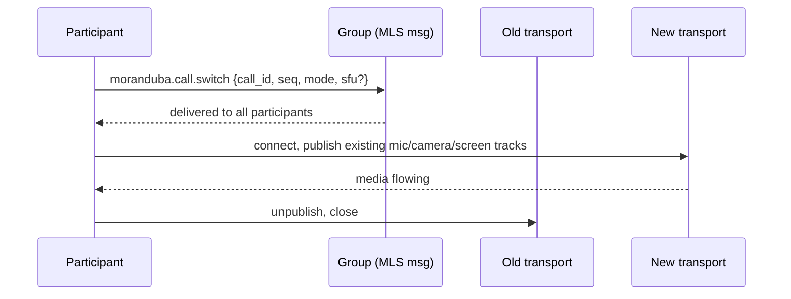

# Moranduba — architecture

Private group chat with video calls and screen share. No accounts: identity is a
Nostr key pair. Every call is end-to-end encrypted, whichever mode carries it.

Status: design, nothing built yet. Kind numbers and message shapes marked
*provisional* are ours and may change.

## Goals

- Friend list and groups over Nostr, no login, no server required to chat.
- Group calls of up to ~15 people with camera, mic and screen share.
- A call runs in one of three modes and can switch mode mid-call.
- Running your own server is one `docker run` and a paste of an npub.
- No component outside the group can read messages, files or call media.

Non-goals for v1: web client, calls larger than ~25, recording, public rooms.

## System overview



| Component | Carries | Sees |
|---|---|---|
| Nostr relays | Chat, invites, call signaling | Ciphertext, timing, recipient pubkeys of gift wraps |
| Blossom servers | Chat attachments | Ciphertext blobs and their size |
| Moranduba SFU (host peer or VPS) | Call media | Encrypted frames, participant IPs, bitrate |
| TURN (when needed) | Call media for peers that can't connect directly | Encrypted packets, IPs |

## Identity and friends

- First launch generates a secp256k1 key pair, stored in the platform secure
  store (Keychain, Android Keystore, libsecret, DPAPI). Import of an existing
  nsec and remote signers (NIP-46, NIP-55) come later.
- Friend requests and 1:1 chat: NIP-17 private DMs (NIP-44 + NIP-59 gift wrap).
- Friend requests are NIP-17 messages carrying a `["moranduba",
  "friend_request"]` tag; the answer carries `["moranduba", "friend_accept"]`.
  Crossed requests count as accepted. Declines are silent.
- The friend list is **not** a NIP-02 contact list (that is public). It is a
  NIP-51 follow set (kind 30000, `d=moranduba-friends`) with every entry in the
  NIP-44-encrypted content, so relays only see that a list exists.

## Groups and chat — Marmot (MLS over Nostr)

- Groups use the Marmot protocol (MLS, as in White Noise) through MDK, via the
  `marmot_dart` binding or our own flutter_rust_bridge wrapper if that binding
  lags.
- MLS gives forward secrecy and post-compromise security, and a new epoch on
  every join, leave or removal.
- Chat messages are Marmot application messages (kind 445 on relays).
- Attachments follow MIP-04: encrypted on device with a key derived from
  `MLS-Exporter("marmot", "encrypted-media", 32)`, uploaded to Blossom.
- Each group has a relay list. Defaults are public relays; a group can add its
  own relay to cut metadata exposure.

### Groups now, channels later

v1 ships plain groups, but the data model is already a space with channels, so
Discord-style communities don't need a migration:

```
Space    { id, name, settings, channels: [Channel] }
Channel  { id, space_id, kind: text | voice, mls_group_id }
```

- v1: every group is a space with exactly one channel, which has both text and
  a call button. The UI hides the space layer.
- Later: a space gets more channels, each backed by its own MLS group, so
  per-channel membership and roles map to MLS membership. Calls and
  `preferred_sfu` are per space; channels inherit them.
- MLS cost grows with members, so spaces above ~100 members need their own
  design pass.

Space settings (MLS application message, *provisional* shape):

```json
{
  "type": "moranduba.settings",
  "space_id": "…",
  "preferred_sfu": "npub1…",
  "host_peers": ["npub1…"],
  "relays": ["wss://…"]
}
```

## Calls

### Media encryption (all modes)

- Frames are encrypted with flutter_webrtc `FrameCryptor` (AES-GCM, SFrame-like)
  before they leave the sender, so any SFU or TURN forwards only ciphertext.
- Call key: `MLS-Exporter("moranduba", "call:" + call_id, 32)` from the group's
  current epoch. When membership changes, the epoch moves on and every client
  sets the new key; FrameCryptor keeps the previous key briefly so in-flight
  frames still decrypt.
- Switching mode never touches the key, so switching is a transport change only.

### Modes

| Mode | Media path | Good for | Limits |
|---|---|---|---|
| `mesh` | Every peer to every peer | Any group, no setup | Audio fine at 15 (~0.5 Mbps up each). Video capped at ~5 senders; one screen share at reduced bitrate |
| `host_peer` | All peers to one member's desktop sidecar SFU | Groups with one member on a desktop with good upload | Needs ~20 Mbps upload on the host for 15 people. Desktop only |
| `server` | All peers to a Moranduba SFU on a VPS | Groups with a server, own or borrowed | Any size up to the VPS bandwidth |

`host_peer` and `server` run the **same SFU binary** and the same client
transport. The only difference is whether the SFU's npub belongs to a member's
desktop or to a VPS.

### Mode selection

At call start, and again whenever the current transport fails:

1. `server` if the group's `preferred_sfu` answers a ping within 3 s.
2. Else `host_peer` if a listed host peer is online and opted in.
3. Else `mesh`.

Any participant can switch the mode by hand at any time. The UI shows the
current mode and a one-tap switch.

### Mid-call switch (make before break)



- Local tracks are reused, so there is no new permission prompt and no capture restart.
- Conflicts: highest `(seq, created_at, pubkey)` wins, so every client converges.
- If the new transport fails within 10 s, clients stay on the old one and post
  a `moranduba.call.switch_failed`.

### Signaling

- Bootstrap: SDP offer/answer and ICE candidates as gift-wrapped events
  addressed to the peer or SFU npub, with an ephemeral outer kind so relays
  don't store them (*provisional*: kind 21059).
- After the first connection, renegotiation (new tracks, simulcast layer
  changes) moves to a WebRTC DataChannel. Relays only see the bootstrap.

### NAT traversal

- STUN finds public addresses. Direct connections work for most home networks.
- A VPS SFU has a public IP and embeds a TURN server (pion/turn), so `server`
  mode always connects.
- `mesh` and `host_peer` without any server: open question, see below.

## Moranduba SFU

- Go, built on Pion. Starting points: Pion's `sfu-ws` example, the
  `inlivedev/sfu` library.
- Features: simulcast (3 layers), per-receiver layer selection, last-N video
  (active speaker plus the 5 most recent), top-3 loudest audio forwarding,
  DataChannel signaling after bootstrap, embedded TURN.
- Identity: generates its own Nostr key pair on first start and prints its npub.
- Ownership: the first start also prints a one-time claim code. The first app
  that sends it becomes the owner. The owner manages an allowlist of member
  npubs; the app syncs it from the group roster. Strangers can't join, and even
  if one did, frames stay encrypted.
- Desktop: the same binary ships as a sidecar in the macOS, Windows and Linux
  app bundles. The app starts it as a subprocess only while hosting.

Server setup, the whole thing:

```sh
docker run -d --name moranduba-sfu \
  --network host \
  -v moranduba-sfu:/data \
  ghcr.io/vzsoares/moranduba-sfu
docker logs moranduba-sfu   # prints npub + claim code
```

No domain, no TLS certificate, no reverse proxy: signaling goes through Nostr,
and media is DTLS-SRTP plus frame encryption.

## Platforms

| Platform | Calls | Screen share | Host peer |
|---|---|---|---|
| macOS, Windows, Linux | Yes | `getDisplayMedia` via flutter_webrtc desktop capturer | Yes |
| Android | Yes | MediaProjection + foreground service | No |
| iOS | Yes | ReplayKit Broadcast Upload Extension (separate target) | No |
| Web | Later | — | No |

## Repo layout

```
moranduba/
  app/       Flutter client
  sfu/       Go SFU (server image + desktop sidecar)
  docs/      This file, ADRs
```

## Phases

| Phase | Scope | Estimate |
|---|---|---|
| 0. Foundations | Repo, identity, relay pool, NIP-17 DMs, friend requests, private friend list | ~1 week |
| 1. Groups + chat | MDK integration, space/channel model, create, invite, leave, text, MIP-04 attachments | ~2 weeks + 2 days |
| 2. Mesh calls | Gift-wrapped signaling, FrameCryptor + MLS call key, audio, video, screen share, auto video cap | ~2 weeks |
| 3. SFU | Go SFU, claim + allowlist, simulcast, last-N, embedded TURN, Docker image | ~3 weeks |
| 4. Host peer + switching | Desktop sidecar packaging, mode selection, make-before-break switch | ~2 weeks |
| 5. Platform polish | iOS broadcast extension, Android foreground service, notifications | ~1 week+ |

## Open questions

1. **TURN without a server.** In `mesh` and `host_peer` with no VPS, roughly
   10–20% of peer pairs can't connect directly. Options: a public TURN service,
   routing through another member, or a community list of TURN servers.
2. **Incoming-call push on mobile.** APNs and FCM need a server to send the
   push. Options: a Nostr push relay, or a group's SFU acting as push proxy.
3. **MDK exporter API.** Confirm MDK exposes `MLS-Exporter` with a custom label
   for the call key. If not, derive the call key via HKDF from the MIP-04
   exporter secret with a distinct info string.
4. **Metadata on public relays.** Gift-wrap recipients and MLS group IDs are
   visible to relays. Document what leaks for users, and suggest an own relay.
5. **SFU quality vs LiveKit.** Plan tuning time for congestion control and
   simulcast switching before calling `server` mode done.

## Prior art

- 0xchat: 1:1 P2P calls with Nostr signaling (`ox_calling`). MIT, reusable.
- HiveTalk (vanilla): mediasoup SFU. AGPLv3, reference only, no code copied.
- Honey (HiveTalk 2.0): LiveKit + NIP-98 auth + NIP-53 rooms.
- Nests: MoQ audio relay + NIP-98 auth sidecar, server lists per user.
- White Noise / Marmot: MLS group messaging over Nostr.
- Stoat (formerly Revolt): Discord-style servers, channels, roles, voice. UX
  reference only: centralized, email accounts, messages stored readable by
  the operator, no E2EE. AGPLv3.
